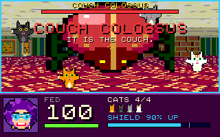

# Cockroaches Cathisteria

Fed is a cat-crazy woman living in a three-story house on South Harper Street, Hyde Park, Chicago, with her feline armada. When an interdimensional portal opens in her basement, unleashing giant alien cockroaches, Fed becomes humanity’s first and last line of defense, with her cats as weapons.

<p align="center"></p>

A compact, Doom-inspired first-person action cartridge for [PRG32](https://github.com/riscv-prg32/PRG32), the RISC-V (ESP32-C6) educational games console. It has a raycast 3D view with textured walls, floors and ceilings; sprite enemies; twelve levels with twelve bosses plus the two invasion leaders; and a portal to seal. It all fits in the 64 KiB cartridge window.

## How to play

| Button | Action |
|---|---|
| UP / DOWN | walk forward / back |
| LEFT / RIGHT | turn |
| SELECT + LEFT / RIGHT | strafe |
| A | send a cat at the enemy in the crosshair (hold to keep sending) |
| B (hold) | raise the feline shield |
| SELECT (tap) | pause |

**The cats are the weapon.** Each press of A sends one cat: it leaps from the bottom of the screen, flies at the enemy under the crosshair (the crosshair turns gold when there is one), mauls it, and trots back. You can only send cats that are at your side, so the number of cats in your armada is your rate of fire.

**The cats are also the shield.** While you hold B the armada circles you with claws out. Bites, poison spit and falling bricks are blocked, but each blocked hit drains shield power, and holding the shield drains it too. It regrows only while you let it rest, and if it runs dry it breaks and must regrow to 30% before it works again. A bigger armada gives a stronger shield, and you cannot send cats while shielding. So the game is a constant choice between attacking and defending.

**Cats get hurt.** A cat that pounces on a beetle, an elite or a boss in mid-attack can be knocked out. Poison can scare a cat into hiding. Such cats appear on the floor, dazed (shown in red in the HUD). Walk over one to bring it back, and every dazed cat comes home when the room boss falls. The armada never drops below one loyal cat.

**Pickups:** a sitting cat (rescue: +1 cat), deep-dish pizza (+35 health), cat food (shield recharged, poison cured) and a ball of yarn (10 s of super shield).

**Enemies:** roaches, fast runners, green spitters, armored beetles (shield their charge and they bounce off, belly-up and vulnerable), steel beetles, red elites and winged roaches. Every level ends with a boss. Bosses mix charges, poison volleys, poison rings, summoned minions, invulnerable shells and crushing jumps. Below half health they become enraged.

## The house

| # | Level | Highlights |
|---|---|---|
| 1 | Front Yard | tutorial roaches, the Lawn Roach |
| 2 | Backyard | beetles, spitters, the Grill Beetle |
| 3 | Kitchen | tight indoor combat, the Crumb Baron; the basement door is sealed... |
| 4 | Chimney | ...so Fed climbs the flue: falling bricks, roaches dropping from above |
| 5 | Roof | holes along the edges, winged roaches, the night skyline |
| 6 | Mansard | a dark attic of boxes and trunks |
| 7 | Third Floor | corridor, guest room, bath; doors open after the first wave |
| 8 | Second Floor | study and library, armored beetles |
| 9 | First Floor | dining room, entrance hall, elite roaches |
| 10 | Living Room | the Couch Colossus, a multi-phase major boss |
| 11 | Basement | flickering lights, pipes, the Furnace Warden |
| 12 | The Portal | elite guard, the Cockroach Queen and General Chitin, four anchors to break under portal surges |

If Fed falls you can retry the level from its start (A) or give up (B).

## Build

You need the [PRG32](https://github.com/riscv-prg32/PRG32) repository next to this one (or set `PRG32_REPO`), and ESP-IDF with the RISC-V toolchain.

```bash
tests/run_tests.sh               # host logic tests + soak (ASan/UBSan)
scripts/build.sh                 # dist/cockroaches-{esp32c6,qemu}.prg32
scripts/pack-store-bundle.sh     # dist/cockroaches-store-bundle.zip
```

Upload to a board or to the emulator:

```bash
cd ../PRG32
python3 -m prg32 esp32c6 upload ../Cockroaches_Cathisteria/dist/cockroaches-esp32c6.prg32 --url http://192.168.4.1
python3 -m prg32 qemu upload ../Cockroaches_Cathisteria/dist/cockroaches-qemu.prg32
```

Other tools:

```bash
python3 tools/gen_levels.py      # levels/*.txt -> src/level_data.h (validates the maps)
python3 tools/gen_assets.py      # procedural art and audio -> src/assets.h, audio/
tests/run_tests.sh shots         # build/shots/*.png, one per screen and level
tests/run_tests.sh cost          # estimated ESP32-C6 frame cost per level
python3 tools/make_store_art.py  # assets/icon.png and assets/screenshot.png
python3 scripts/qemu_preview.py --script play --out build/preview   # real firmware in QEMU
```

## Repository layout

```text
src/        the cartridge (a unity build: main.c includes every module)
levels/     one ASCII map + header per level (see tools/gen_levels.py for the legend)
tools/      level compiler, procedural asset generator, store art, 64 KiB CLI adapter
audio/      the AUDIO block description and its four PCM waves
tests/      host test harness (stubs, framebuffer, tests, screenshots, cost model)
scripts/    cartridge build, store bundle, QEMU preview
metadata/   Cartridge Store metadata and colophon
docs/       design and technical notes
```

[`docs/design.md`](docs/design.md) explains the renderer, the memory budget, the game systems and the measurements.

## Technical profile

- Portable PRG32 ABI-table cartridge: 52.7 KB code and data plus 10.6 KB bss = 63.2 KB of the 64 KiB cartridge RAM. The store image is 62.3 KB.
- Integer DDA raycaster (160 rays) with floor/ceiling casting, distance fog and a Chicago skyline for outdoor levels.
- Frames are composed in 4-row strips of 8-bit colour indices and blitted with `prg32_sprite_draw_indexed`, using a 216-colour palette that maps exactly onto the ESP32-C6 system colour cube.
- 30 Hz fixed-step simulation, fixed-size object pools, no dynamic allocation, no floating point.
- Data-driven levels and a single reusable boss framework.
- Procedural pixel art: 37 textures, 34 sprite frames and 72 palettes, generated by `tools/gen_assets.py`.
- Seven-instrument AUDIO block with a software effects sequencer and three-voice music.

## License

MIT, see [LICENSE](LICENSE). Concept and direction: Raffaele Montella (UniParthenope). Implementation and procedural pixel art: Claude Code. The 8x8 font comes from the PRG32 firmware.
